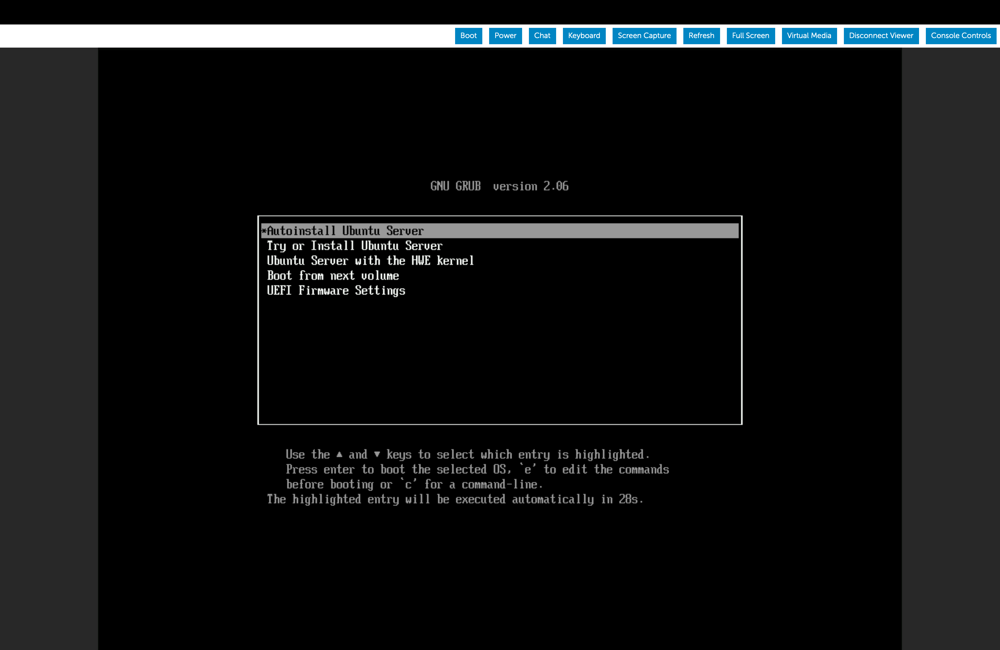

# Ubuntu Autoinstall ISO Guide

This guide explains how to create a custom autoinstall ISO for Ubuntu 26.04 live server with pre-configured installation options.

## Reference Documentation

- **Ubuntu AutoInstall Documentation**: [Ubuntu AutoInstall Documentation](https://canonical-subiquity.readthedocs-hosted.com/en/latest/reference/autoinstall-reference.html)

## Prerequisites

Install the following packages:

- **7z**: For unpacking the source ISO, including partition images. On Ubuntu 22.04 and older the package is `p7zip-full`.

  ```bash
  sudo apt install 7zip
  ```

- **wget**: To download the Ubuntu 26.04 server ISO.

  ```bash
  sudo apt install wget
  ```

- **xorriso**: For building the autoinstall custom ISO.

  ```bash
  sudo apt install xorriso
  ```

## Step-by-Step Guide

### Step 1: Move to the ISO Files directory and download the required version of Ubuntu

```bash
cd ~/lab/ansible/iso_files
mkdir source-files
wget https://releases.ubuntu.com/26.04/ubuntu-26.04.1-live-server-amd64.iso
```

### Step 2: Extract the ISO contents

Use 7z to unpack the ISO. It will extract MBR and EFI partition images automatically.

```bash
7z -y x ubuntu-26.04.1-live-server-amd64.iso -osource-files
```

### Step 3: Move the [BOOT] directory for easier access

```bash
cd source-files
mv '[BOOT]' ../BOOT
cd ..
```

`BOOT` now holds `1-Boot-NoEmul.img` (the BIOS boot image) and `2-Boot-NoEmul.img` (the EFI partition), which Step 8 needs.

### Step 4: Edit the ISO grub.cfg File

Open **source-files/boot/grub/grub.cfg** and add the following menu entry above the existing ones (it should be the first menuentry option).

This option will be shown during the Booting process as **Autoinstall Ubuntu Server** and be automatically selected in 30 seconds, if there is no input from the user.


#### If the server configuration files (**user-data** and **meta-data**) needs to be local to the ISO, then use the below menuentry definition

```bash
menuentry "Autoinstall Ubuntu Server" {
set gfxpayload=keep
linux   /casper/vmlinuz quiet autoinstall ds=nocloud\;s=/cdrom/server/  ---
initrd  /casper/initrd
}
```

#### If the server configuration files (**user-data** and **meta-data**) are stored on a remote server, and be picked dynamically use the below menuentry definition, and make sure the web server is up and running and the files as accessible

```bash
menuentry "Autoinstall Ubuntu Server" {
set gfxpayload=keep
linux   /casper/vmlinuz quiet autoinstall ds=nocloud\;s=http://172.22.0.1/server/  ---
initrd  /casper/initrd
}
```

Where the **server** folder contains the **user-data** and the **meta-data** files, and `172.22.0.1` is mgmt (see [Hosting Files on a Webserver](hosting_files_on_webserver.md)). Keep the trailing `/` in the URL.

### Step 5: Prepare the auto-install configuration files

The **server** directory in `~/lab/ansible/iso_files` already holds the sample files:

- [meta-data](../ansible/iso_files/server/meta-data): cloud-init requires it to exist, and it sets the hostname for the instance.
- [user-data](../ansible/iso_files/server/user-data): the autoinstall configuration (user, locale, SSH, disk layout). Add your own settings here, see the Ubuntu Autoinstall documentation.

The file must start with `#cloud-config`, and every setting must be nested under the `autoinstall:` key.

### Step 6: Set the password

Under the identity section, the **user-data** file needs a hashed password. Generate it and write it into the file:

```bash
HASH=$(openssl passwd -6)
sed -i "s|password: \".*\"|password: \"$HASH\"|" ~/lab/ansible/iso_files/server/user-data
```

`openssl` prompts for the password twice. Do not commit the edited **user-data** file.

### Step 7: Place the server directory

If the server configuration files need to be local to the ISO, then copy the **server** folder into the **source-files** directory:

```bash
cp -r server source-files/
```

Else, copy the **server** folder to the remote web server.

### Step 8: Generate the Custom Ubuntu 26.04 Autoinstall ISO

Make sure this is the directory structure before you run the below commands

```plaintext
iso_files
├── ubuntu-26.04.1-live-server-amd64.iso
├── BOOT
├── source-files
│   ├── server
│   │   ├── meta-data
│   │   └── user-data
│   ├── boot
│   ├── └── grub
│   ├────── └── grub.cfg
│   ├── casper
│   ├── dists
│   ├── EFI
│   ├── install
│   ├── md5sum.txt
│   ├── pool
│   └── boot.catalog
```

To generate the custom Ubuntu 26.04 autoinstall ISO, you can use the following command

```bash
cd source-files

xorriso -as mkisofs -r \
-V 'Ubuntu 26.04 LTS AUTO (EFIBIOS)' \
-o ../ubuntu-26.04-autoinstall.iso \
--grub2-mbr ../BOOT/1-Boot-NoEmul.img \
-partition_offset 16 \
--mbr-force-bootable \
-append_partition 2 28732ac11ff8d211ba4b00a0c93ec93b ../BOOT/2-Boot-NoEmul.img \
-appended_part_as_gpt \
-iso_mbr_part_type a2a0d0ebe5b9334487c068b6b72699c7 \
-c '/boot.catalog' \
-b '/boot/grub/i386-pc/eltorito.img' \
-no-emul-boot -boot-load-size 4 -boot-info-table --grub2-boot-info \
-eltorito-alt-boot \
-e '--interval:appended_partition_2:::' \
-no-emul-boot \
.
```

This will create a new autoinstall iso with the name: **ubuntu-26.04-autoinstall.iso**, that can be used for installation.

### Subsequent Autoinstall ISO updates

For updates to the Autoinstall ISO:

If the server configuration files are local to the ISO, then update the configuration files (**user-data** and **meta-data** files) in Step 5 and Step 6, copy them again in Step 7, then run **xorriso** command in Step 8 to create an updated ISO.

Else, if the server configuration files are stored on a remote server. All you need to do is just make the modifications to the **user-data** and the **meta-data** file in the remote server and re-install the OS using the same ISO. It will automatically pick the latest updates.
