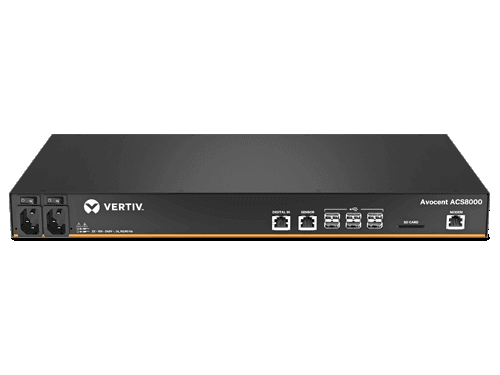
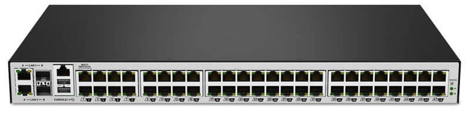

# Serial Consoles

IP to serial switch for remote access to the devices serial port
ACS8032 32-port unit, internal modem, dual AC power supply

## HW spec

- Model: ACS8032 with internal modem and dual power supply
- Firmware: 2.30.2.6525+920+41+18 (Jul 9 2025 - 20:45:03)

## Management

- 1G ethernet management port, ToR Et3, 172.22.4.104 (static; dhcpd reserves 172.22.0.30)
- Security profile "Secure": SSH and HTTPS only, no telnet, no ping
- Serial port N: `ssh -p $((8000+N)) admin@172.22.4.104`, hot key `^Z`

## Docs

[User guide](https://www.vertiv.com/49db15/globalassets/shared/avocent-acs-8000-installer-userguide.pdf)

## Devices connected

Checked 2026-10-19 by opening each port.

| Port | Name        | Device                         | Speed  |
|------|-------------|--------------------------------|--------|
| 1    | Network-PDU | Vertiv Geist rack PDU          | 115200 |
| 2    | A100G       | Arista DCS-7280CR-48-F (A100G) | 9600   |
| 3    |             | unknown, no output             | 19200  |
| 4    | BIG-IP-02   | F5B, BIG-IP i4000              | 19200  |
| 5    | ToR         | Arista DCS-7280TR-48C6-R       | 9600   |
| 6    |             | unknown, no output at any rate | 19200  |
| 7    | BIG-IP-01   | F5A, BIG-IP i4000              | 19200  |

## Pictures

